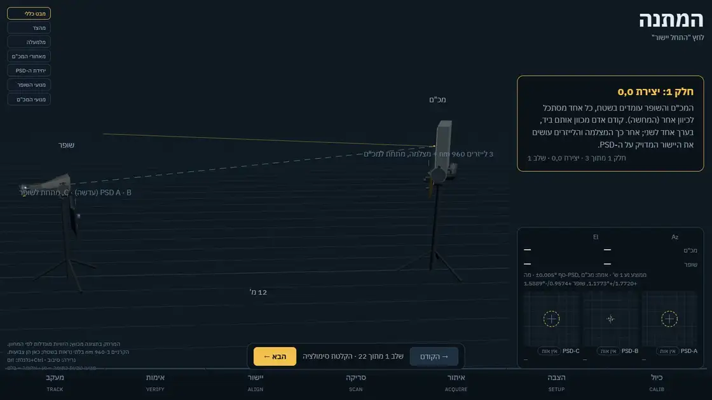

# Rada-Align

Autonomous alignment of a horn antenna to a radar in a field test, without using any radar data. Built for the DRS RADA challenge at a KIC / Kinneret hackathon (November 2026). We did not reach the final; this repository is what we built.



*The guided tour of the simulation (assumed parameters, not hardware). Three parts: the system creates the 0,0 alignment, keeps it when the horn is knocked and the radar is moved, and the radar returns to the same point on its encoders with the lasers off. To present it in class without Python, open [docs/media/RADA_Align_class_demo.html](docs/media/RADA_Align_class_demo.html) in Chrome or Edge (download it first): "next" and "back" step through the same tour.*

## The problem

A horn antenna stands 10-15 m from a radar under test and must point straight at it, and the radar must point straight at the horn: residual error within +/-0.05 deg in azimuth and elevation (the mentor tightened it to 0.005 deg), set up by hand to within about 1 deg and 25 cm, with no radar data and no radio near the radar (it works in C-band, 4-8 GHz).

## The design (docs/FINAL_DESIGN.md)

- **Raster scan + PSD + NanoTrack.** Three 960 nm Class 1 lasers and a camera on a board clamped to the radar's mechanical datum, parallel to its axis; three position-sensitive detectors (PSDs) on the horn. PSD-A reads the radar error (the spot moves d*pi/180 mm per degree, 209 mm/deg at 12 m), PSD-B sits behind a lens and reads the beam angle (horn error), PSD-C is a third position reading and a cross-check. Two inclinometers give gravity, relative roll and the height difference (R3).
- **Both sides on motorised pan/tilt/roll rotary stages** with optical encoders; the radar is braked during the test and only monitored.
- **State machine:** CALIB -> SETUP -> ACQUIRE (camera template match, NanoTrack AI tracker) -> SCAN (raster with the radar until 2 of 3 beams land) -> ALIGN (both loops together) -> VERIFY (|mean| + 2 sigma < tolerance per axis over 5 s) -> TRACK, plus FAULT.

## What the simulation shows (all numbers from runs in docs/PROGRESS.md)

- **Demo profile** (no wind, drift or calibration residuals), 12 m, 200 Monte Carlo runs scored against truth: reported pass 100 %, true pass 100 %, false accepts 0 %; 93 % also pass with the calibration uncertainty U_bias added.
- **With every assumed error source on, 0.005 deg is not reached:** 0 % at 2, 12 and 15 m, dominated by wind on the braked radar. The original 0.05 deg requirement was the design target; see docs/FINAL_DESIGN.md section 0.3.
- **Motors:** a stage of the Newport RV class (0.001 deg or finer minimum step) resolves the requirement; a pan-tilt with 0.0064 deg steps does not (2 % pass). A step test with the PSD as the judge sees every 0.001 deg step at 12 m.
- `pytest -q`: 140 passed, 4 expected failures (the superseded first design cannot meet 0.005 deg).

Everything here is simulation with parameters marked ASSUMPTION in config.yaml; nothing was validated on hardware.

## Run the demo

```bash
python -m pip install -e ".[dev]"
python -m rada_align.psd
```

Open http://127.0.0.1:8001 and press "הדגמה מודרכת" (guided tour, Hebrew UI). Monte Carlo of the final design:

```bash
python -m rada_align.psd.montecarlo --runs 200 --distance 12
```

## Setup

One venv per OS (a Windows venv does not work from WSL and vice versa).

Windows (PowerShell, from the repo root):

```powershell
py -3.11 -m venv .venv
.venv\Scripts\Activate.ps1
python -m pip install -e ".[dev]"
pytest -q
```

The venv itself is not in the repo (455 MB and tied to one machine). To get the exact package versions it was tested with (Python 3.11.9), install from `requirements-lock.txt` instead:

```powershell
python -m pip install -r requirements-lock.txt
python -m pip install -e . --no-deps
```

If activation is blocked: `Set-ExecutionPolicy -Scope Process RemoteSigned`, or skip activation and call `.venv\Scripts\python.exe -m pytest -q`.

WSL (needs a Linux distro, e.g. `wsl --install -d Ubuntu`; keep the venv off /mnt/c, it is slow there):

```bash
sudo apt update && sudo apt install -y python3-venv python3-pip
python3 -m venv ~/.venvs/rada-align
source ~/.venvs/rada-align/bin/activate
cd /mnt/c/path/to/Rada-Align
python -m pip install -e ".[dev]"
pytest -q
```

Camera and ESP32 code must run from the Windows venv (WSL2 has no USB webcam or serial access by default).

## Run

Simulator (Monte Carlo table and plots in ./out):

```bash
python -m rada_align.sim --runs 500 --distance 12
```

Operator dashboard against the simulator, then open http://127.0.0.1:8000 :

```bash
python -m rada_align.ui --distance 2
```

Camera tools (native Windows Python, from the repo root with the venv active):

```bash
python scripts/measure_stability.py --fake --seconds 30
```

```bash
python scripts/measure_stability.py --device 0 --seconds 30
```

```bash
python scripts/calibrate_camera.py --images calib/chessboard --cols 9 --rows 6 --square-mm 25
```

`--fake` uses a synthetic spot (no camera is opened). `--device N` opens camera N; if the wrong camera opens, try 1, 2.

## Docs

- Final design: docs/FINAL_DESIGN.md
- Demo guide (Hebrew): docs/DEMO_GUIDE.md
- Project notes for the coding assistant: CLAUDE.md
- Challenge and analysis: docs/CHALLENGE.md
- Task list: docs/TASKS.md
- Progress log: docs/PROGRESS.md
- Questions for mentors: docs/OPEN_QUESTIONS.md
